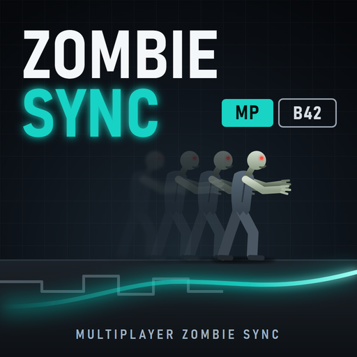

# ZombieSync MP

<p align="center"></p>

**Smooth multiplayer zombies for Project Zomboid (Build 42.21+)**

> Status: live-tested on a local dedicated server with two clients, also over an emulated internet connection like a friend's (lag spikes, packet loss) with server hitches; not yet in a full session on a public server.

In vanilla B42, zombies that another player is fighting move in jerks on your screen: an update arrives every 0.2 s, the zombie walks toward an old guessed point, teleports (to the corner of a tile) when it falls 3 tiles behind, and snaps its head and body around on every packet. There is also a vanilla bug: if your copy of the other player lies on the ground for a moment, zombies on your screen sit down to "eat" them while the real zombies keep running, then jump into place.

With ZombieSync:
- a remote zombie is drawn along the path it really walked on its host's machine, a steady ~0.15–0.2 s behind (based on send time stamps);
- between packets it follows a smooth curve; prediction misses are blended out with a spring, without jerks or teleports; walls and collisions work as usual;
- it turns smoothly instead of snapping on every packet and faces where the host's zombie faces, also while biting;
- a remote zombie bites when its host's zombie does, and starts eating only if its host decided so;
- other players near you are drawn on the same clock as the zombies: their position is sent 10 times a second (vanilla: on every new tile, 8-way turn or 0.6 s) and your copy of them follows the path they really walked, so a zombie bites the player you see, not the air ahead of them;
- lag spikes and server hitches (world save, loading new map areas) are ridden out: zombies slow down and catch up afterwards instead of freezing and jumping; after a hitch longer than the buffer (1.5 s by default) each zombie makes one clean jump (new in 1.1.0);
- zombies you simulate are sent 4x more often (every 50 ms instead of 200), within an upload budget (256 KB/s by default: the full rate up to ~250 zombies, then a gradually longer period).

Falls, hits, climbing over fences and through windows, getting up are played with the game's own animations; the mod only records data during them and then picks the zombie up smoothly.

Client-side Java mod (requires ZombieBuddy). Every player must have it. If anything goes wrong it switches itself off and vanilla sync is used (`[ZombieSync] disabled ...` in the log).

<p align="center"><a href="https://boosty.to/lrgpp"></a></p>

Free and open source. The code is written by an AI; the direction, the testing and the time are mine. If the mod made your game better: [support on Boosty](https://boosty.to/lrgpp).

## What's new in 1.1.0
- **Fixed: zombies teleporting back and forth for a player who joins over the internet.** Two causes in 1.0.3:
  - after a server hitch the server first passes on the update that has been waiting since the hitch began (2.5–4 s old). 1.0.3 took it for a fresh one and drew the old position after the new one, so the zombie jumped back and then forward again;
  - when updates stopped, the zombie froze after 0.2 s, was handed to vanilla after 1.2 s, and was dragged to its place at up to 20 tiles/s when updates resumed.

  Now late updates keep their real time, updates too old to place are dropped, and a gap in the data is ridden out in slow motion (up to the lag-spike buffer, 1.5 s by default), with the time given back in slightly fast motion afterwards. After a longer hitch there is no data for that stretch at all, and each zombie makes one clean jump (1.0.3: several frames of dragging).
- **Settings are now in the host's sandbox options** (page ZombieSync MP): the same for everyone and changeable in a running game. Options > Mods keeps only the personal stats switches. An old `ZombieSyncMP.properties` no longer pins the old timings: values still at the 1.0 defaults are replaced once.
- NPCs that Project A-Life builds on zombie bodies are left to vanilla sync (their own client logic expects it).
- The console shows the version: `[ZombieSync] loaded 1.1.0.`

## What's new in 1.0.3
- Fixed: with a big horde the faster sending switched itself off (the 64 KB/s upload cap fell back to vanilla's 200 ms above ~60 zombies per host). The cap is now 256 KB/s: the full 50 ms rate up to ~250 zombies, then a gradually longer period.
- Load measured: the mod's hooks take under 2% of one core on a client with 300 remote zombies and under 0.3% on their host. Setting `profile=true` prints the CPU time of each hook with the stats.

## Installation
**Required on every client and in the server mod list.**

Steam Workshop: subscribe to [ZombieBuddy](https://steamcommunity.com/sharedfiles/filedetails/?id=3619862853) (2.3.4+) and [ZombieSync MP](https://steamcommunity.com/sharedfiles/filedetails/?id=3827946115). On the server add `ZombieSyncMP` to `Mods=` (after ZombieBuddy) and `3827946115` to `WorkshopItems=`.

Manual install:
1. Install **ZombieBuddy** 2.3.4+.
2. Download `ZombieSyncMP_1.1.0.zip` from [Releases](https://github.com/druidqwerty/ZombieSyncMP/releases), delete the old `ZombieSyncMP` folder and unpack the new one into `%UserProfile%\Zomboid\mods\`
   - You should see `... \mods\ZombieSyncMP\42\mod.info` and `... \42\media\java\ZombieSyncMP.jar`
3. Add `ZombieSyncMP` to your server's `Mods=` list (after ZombieBuddy).

ZombieBuddy asks once for Java mod permission for the new ZombieSyncMP jar — allow it (every player).

## Configuration
**Server-wide (same for every player): the host's sandbox options, page ZombieSync MP.**
Main menu: Host > Manage settings > Edit > Sandbox > ZombieSync MP (dedicated server: `SandboxVars.ZombieSyncMP` in `YourServer_SandboxVars.lua`).
An admin can change them in a running game (Admin > Sandbox options); every client applies them within 2 s, no restart.

| Option | Default | |
|---|---|---|
| Enable ZombieSync | on | off = vanilla zombie and player sync for everyone |
| Smoothness mode | Balanced | Balanced: zombies ~0.2 s behind. Smooth: even smoother, 30–50 ms more. Realtime: the least delay, more prediction |
| Zombie send interval, ms | 50 | how often a player sends the zombies his game simulates while another player is near; 200 = vanilla |
| Zombie upload cap per player, KB/s | 256 | above it the interval grows back toward 200 ms (256 keeps 50 ms for ~250 zombies) |
| Ride out lag spikes up to, ms | 1500 | how long a gap in the data zombies ride out by slowing down; after a longer one, one clean jump |
| Draw players on the zombies' clock | on | players send their position 10 times a second while another player is near |
| Attacks follow the simulating game | on | a remote zombie bites when (and as long as) it bites in its host's game |
| Eating only when it eats in the simulating game | on | no more zombies "eating" a player who is standing |

**Personal: Options > Mods > ZombieSync MP** — only diagnostics: write stats to console.txt, stats interval.

`%UserProfile%\Zomboid\ZombieSyncMP.properties` holds tuning values for testing (`minDelayMs`, `maxExtrapolationMs`, `idleTimeoutMs`, `correctionTimeMs`, `snapDistance`, `profile`, ...); normally nothing there needs editing (the server's values win over it).

## Is it working?
`%UserProfile%\Zomboid\console.txt` has `[ZombieSync]` lines:
- `loaded 1.1.0. ...` — the version that is installed;
- `settings (server): ...` — the host's settings arrived (again after an admin changes them);
- `owner: N zombies, send period 50 ms, ...` — zombies you simulate (every 30 s);
- `remote: N zombies, ... delay avg 160 ...` — zombies other players simulate (every 30 s);
- `players: N, ... delay avg ...` — other players the mod draws (every 30 s).

In the debug Lua console: `ZombieSync_status()` — state, delay, number of zombies.

## Live test
Local dedicated server + two clients (zombie host and observer), 16 zombies chasing the host, who walks, runs and stops like a player at the keyboard, 145 FPS. Vanilla and the mod alternate every minute in the same session with the same zombies (2026-10-28).

Internet like a friend's (round trip ~130 ms ±30, 1.5% loss, lag spikes of 0.3–1 s every 10–30 s) plus server hitches of 0.3–3.8 s about every 25 s, lag-spike buffer 1.6 s:

| | vanilla | 1.0.3 | 1.1.0 |
|---|---|---|---|
| zombie drawn behind real position | 310 ms | 225 ms | 225 ms |
| mean position error | 0.51 tiles | 0.35 tiles | 0.39 tiles |
| teleports after lag spikes | 8 | 2 | 0 |
| teleports after server hitches | 40 | 14 | 45 * |
| other teleports | 66 | 0 | 0 |
| frames where a zombie is dragged (> 8 tiles/s) | 2151 | 1006 | 84 |
| moving backwards, per 1000 frames | 1.98 | 1.90 | 0.58 |
| biting zombie to the player you see | 1.38 tiles | 0.64 tiles | 0.65 tiles |

\* All 45 after the 4 hitches longer than the buffer (1.9–3.8 s): one clean jump for each zombie that moved meanwhile. None after lag spikes or shorter hitches. 1.0.3 handed the zombies to vanilla instead (51 times) and dragged them back afterwards.

Normal connection (local, no lag):

| | vanilla | 1.0.3 | 1.1.0 |
|---|---|---|---|
| zombie drawn behind real position | 240 ms | 185 ms | 190 ms |
| mean position error | 0.36 tiles | 0.20 tiles | 0.17 tiles |
| teleports | 64 | 0 | 0 |
| mean facing error | 5.6° | 1.2° | 2.0° |
| biting zombie to the player you see | 1.24 tiles | 0.63 tiles | 0.56 tiles |

With 300 zombies on one host: drawn 185 ms behind (vanilla 235), mean error 0.16 tiles (0.22); the mod's hooks take 1.4% of one core on the observer and 0.2% on the host. Together with PZ Optimization, AnimationTweaks, SmoothRide 1.1.0 and TrippingZombies the zombies the mod drives are as accurate as in 1.0.3's test (TrippingZombies: see Known issues).

## Known issues
- Tripping Zombies: in multiplayer every player's game rolls its own trips, so a zombie falls on one player's screen and keeps running on the other's, and a copy lying on the ground is teleported every 3 tiles until it gets up. The same happens without ZombieSync. Fixed by the add-on [Tripping Zombies MP Fix](https://steamcommunity.com/sharedfiles/filedetails/?id=3829034899): the trip is rolled once, by the game that runs the zombie, and every player sees the same fall.
- A server hitch longer than the lag-spike buffer ends in one jump: there is no data for that time. The buffer can be raised (up to 4000 ms); zombies then stay further behind for a while after a long hitch.

## Please note
- The code is written by an AI, not by a human.
- It was made only for playing with a friend.
- Live-tested on a local dedicated server, also with an emulated internet connection and server hitches. The 1.1.0 fixes come from the logs of a server hosted from the game menu, and the host's settings page was checked there; a full session with a friend on 1.1.0 is still to come.

## Building from Source
Requires Java 25+ and the game + ZombieBuddy jars.

```
JDK=/path/to/jdk-25/bin GAME=/path/to/ProjectZomboid MODVER=1.1.0 tools/build.sh
```

The script builds `build/ZombieSyncMP.jar`, assembles the mod folder in `dist/ZombieSyncMP/` (with `42/mod.info` and `42/media`) and runs the offline simulator (`test/`: links from LAN to a bad one, lag spikes, server hitches with the server's stale-update behaviour).

## My mods
- [SmoothRide MP](https://steamcommunity.com/sharedfiles/filedetails/?id=3827367565) — smooth multiplayer vehicles.
- **ZombieSync MP** — smooth multiplayer zombies (this mod).
- [Tripping Zombies MP Fix](https://steamcommunity.com/sharedfiles/filedetails/?id=3829034899) — the same Tripping Zombies trips for every player.
- [Wandering Hordes Save Trim](https://steamcommunity.com/sharedfiles/filedetails/?id=3829140377) — no more save freezes from Wandering Hordes' wall map.
- [Download Unstuck](https://steamcommunity.com/sharedfiles/filedetails/?id=3829163351) — un-sticks and speeds up the Workshop download when hosting from the menu.

## License
MIT License — see LICENSE file.

## Author
[druidqwerty](https://github.com/druidqwerty)

For questions or issues, open a GitHub issue.
